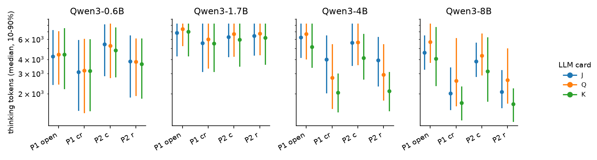

# Tanking

In poker, how long a player takes to act ("tanking") is a tell. Reasoning models think longer on hard decisions, so
their thinking time might leak their private card. This project measures that leak in chips for Qwen3 reasoning
models playing Kuhn and Leduc poker. It then compares defenses that remove the leak, and fixes that make the model
play better and run faster.

Everything is exact: Nash equilibria by CFR+, best responses on the full game tree, padding by linear programming
and a supervised solver-distilled LoRA. There is no reinforcement learning. The plan ([`PLAN.md`](PLAN.md)) was
written before any result, and every change since is logged in [`DEVIATIONS.md`](DEVIATIONS.md).

## Results in brief

- **One of four models leaks its card through thinking time.** An opponent who sees Qwen3-4B's thinking time, as
  well as its actions, wins an extra **+17.7 mbb/hand** (95% CI +11.7 to +27.7) in Kuhn poker. A pre-registered
  replication on fresh samples gave +19.7 (+11.1 to +34.6).
  - The mechanism is simple: with the best card (king), 4B thinks less. At the decisions its opponent can still
    react to, the median is 17–27% lower (opening: 5,149 tokens with a king against 6,227 with a jack and 6,675 with
    a queen). The gap is about 2× when 4B faces a bet, but that is its last action of the hand, so it cannot be
    exploited.
  - Qwen3-0.6B, 1.7B and 8B show no exploitable tell. 8B's thinking time does carry information about its card
    (+0.12 bits per decision, twice 4B's +0.06), but not in a way an opponent can turn into chips.
- **Leduc is inconclusive by design.** A calibration on synthetic tells shows that at the 64 samples per
  information set the Leduc runs could afford, the estimator is biased by −60 to −90 mbb/hand and cannot detect even
  a 240 mbb/hand tell. At 512 samples it works (85–90% power, no false positives).
- **Optimal padding is 3–4 times cheaper than naive padding.** Removing 4B's leak with a linear-program padding
  schedule adds 990 thinking tokens per decision. Padding every decision to the cap adds 3,206, and random padding
  needs about 4,100.
- **Thinking helps, but a solver-distilled model is far better and over 2,000 times cheaper.**
  - In Kuhn, thinking models are exploitable by 141–330 mbb/hand; with thinking off they sit at 332–334. In Leduc,
    1,487–1,708 against 1,509–2,367.
  - Qwen3-0.6B and 1.7B fine-tuned on the equilibrium strategy, with thinking off, are exploitable by 4.7–12 mbb/hand
    in Kuhn and 242–325 in Leduc. They answer in about 7 ms per decision, against a median of 8.6–36 s for the
    thinking models.
  - They generalize to held-out bet sizes and deck sizes: 2–8 times less exploitable than the same base model.
- **Thinking time is wall-clock time.** Single-stream latency is linear in thinking tokens (R² ≥ 0.999), at 2.9 ms
  per token for 0.6B and 7.9 ms for 4B on an A100, so token counts are a faithful proxy for what an opponent sees.

Full numbers are in [`RESULTS.md`](RESULTS.md).



## Demo

A bot that reads thinking time names the LLM's card, replayed from saved Qwen3-4B Kuhn traces:

```
$ python experiments/demo.py runs/kuhn/4B/think
Player 1, history 'cr': thought  5562 tokens, then fold. Bot: 'you hold J' (93%). Truth: J  ✓
Player 2, history 'r': thought  2338 tokens, then call. Bot: 'you hold K' (59%). Truth: K  ✓
Player 2, history 'r': thought  1845 tokens, then call. Bot: 'you hold K' (65%). Truth: K  ✓
...
Card named correctly over 3072 replayed decisions (self-play weighted): 63.3% reading time vs 57.0% from actions alone.

$ python experiments/demo.py runs/kuhn/4B/think --pad
...
Card named correctly over 3072 replayed decisions (self-play weighted): 58.6% reading time vs 57.0% from actions alone.
```

## Layout

| Path | Contents |
|---|---|
| `tanking/` | Game trees and CFR+ (`games`, `solve`), trace data, leak estimator, padding LP and budgets, vLLM engine |
| `experiments/` | Sampling, analysis, defenses, distillation, serving benchmark, calibration, demo, report, Slurm submit |
| `results/` | Analysis, defense, benchmark, calibration and replication outputs, and `tables.md` |
| `figures/` | Tell, leak, padding frontier and strength-vs-cost figures |
| `tests/` | Game, solver, estimator and defense tests |

## Running

Requires Python 3.12 and [uv](https://docs.astral.sh/uv/).

```bash
uv sync
uv run pytest                         # CPU tests
experiments/submit.sh kuhn            # thinking traces for every model (Slurm, one GPU per shard)
experiments/submit.sh leduc
experiments/submit.sh distill         # solver-distilled LoRA, then thinking-off evaluation
experiments/submit.sh heldout
experiments/submit.sh bench
experiments/submit.sh calibrate       # CPU
uv run experiments/postprocess.sh     # analysis, defenses, figures and tables
```

The Slurm scripts target Princeton's Della cluster; adapt `scripts/job.sbatch` and `scripts/cluster_env.sh`.
