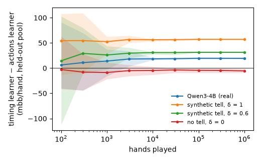
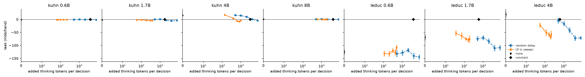
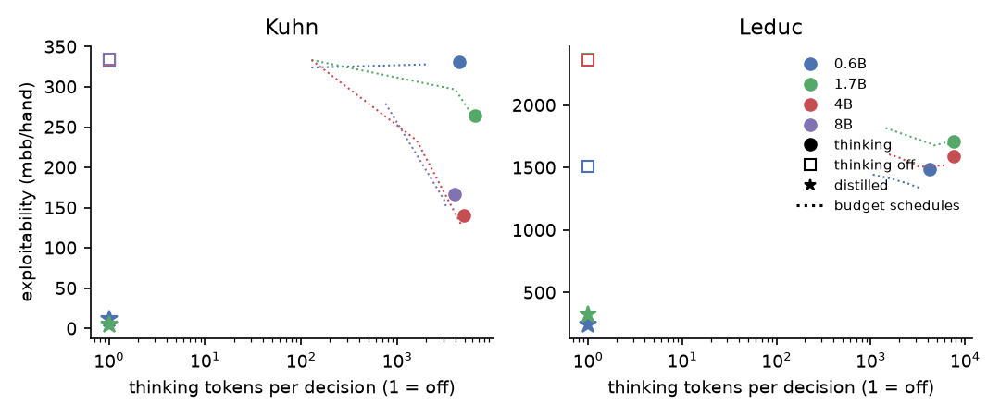

# Tanking

In poker, how long a player takes to act ("tanking") is a tell. Reasoning models think longer on hard decisions, so
their thinking time might leak their private card. This project measures that leak in chips for Qwen3 and two other
reasoning models playing Kuhn and Leduc poker, tests whether an opponent can learn it in play, and compares defenses that
remove it with fixes that make the model play better and run faster.

Equilibria (CFR+) and best responses are computed on the full game tree, padding is solved as a linear program, and
the improved player is a supervised solver-distilled LoRA. There is no reinforcement learning.

## Results in brief

- **In Kuhn poker, one model has a confirmed thinking-time tell: Qwen3-4B.** An opponent who sees its thinking time,
  as well as its actions, wins an extra **+17.7 mbb/hand** (95% CI +11.7 to +27.7). A pre-registered replication on
  fresh samples gave +19.7 (+11.1 to +34.6). With the best card (king), 4B thinks 17–27% less at the decisions its
  opponent can still react to. Qwen3-0.6B, 1.7B and 8B and DeepSeek-R1-Distill-Qwen-7B show no tell.
  Phi-4-mini-reasoning shows no confirmed tell, but a third of its traces hit the thinking cap, so its result is
  unresolved.
- **An opponent can learn the tell in a few thousand hands.** A Bayesian opponent that starts knowing nothing and
  learns only from the hands it plays wins +18 mbb/hand more than one that ignores timing after 3,000 hands. From that
  point the lower 95% bound of its cumulative extra winnings stays above zero. By a million hands its advantage is
  +19.4, close to the full-information value.
- **Leduc is inconclusive by design.** At the 64 samples per information set the budget allowed, a calibration on
  synthetic tells shows the estimator is biased by −60 to −90 mbb/hand and cannot detect even a 240 mbb/hand tell.
  At 512 samples it works (85–90% power, no false positives).
- **Optimal padding is 3–4 times cheaper than naive padding.** Padding is fit on one half of the traces and scored
  on the other, where 4B's unpadded leak is 15.2 mbb/hand (the half-sample counterpart of the full-data 17.7). Removing
  it with a linear-program padding schedule adds 990 thinking tokens per decision. Padding every decision to the cap adds 3,206, and random padding
  needs about 4,100.
- **Thinking helps, but a solver-distilled model is far better and far cheaper.** Thinking roughly halves the larger
  models' exploitability in Kuhn. Qwen3-0.6B and 1.7B fine-tuned on the equilibrium, with thinking off, are 5–30 times
  less exploitable than any thinking model and generalize to held-out deck and bet sizes. In Leduc they use
  2,300–6,200 times less GPU time per hand than thinking models of the same size and answer in under 10 ms.
- **Thinking time is wall-clock time.** Single-stream latency is linear in thinking tokens (R² ≥ 0.999), at 2.9 ms
  per token for 0.6B and 7.9 ms for 4B on an A100, so token counts are a faithful proxy for what an opponent sees.


Units throughout are mbb/hand (1 chip = 1,000 mbb), averaged over both seats. "Leak" is the extra value an exact
best-responding opponent gains by seeing thinking time, bucketed into quantiles per decision point (Kuhn 4 buckets,
Leduc 3), on top of seeing actions. It is cross-fitted across halves of the traces, so it is conservative.

## Does thinking time leak the card?

| Game | Model | Thinking tokens/decision | Truncated at cap | Leak [95% CI] | Null control [95% CI] | Bits gained |
|---|---|---:|---:|---|---|---:|
| Kuhn | Qwen3-0.6B | 4,379 | 4% | −1.0 [−3.5, +3.0] | −0.6 [−2.9, +2.2] | −0.019 |
| Kuhn | Qwen3-1.7B | 6,409 | 19% | +0.3 [−7.7, +8.2] | −1.6 [−8.1, 0.0] | −0.003 |
| Kuhn | **Qwen3-4B** | 4,984 | 8% | **+17.7 [+11.7, +27.7]** | −2.5 [−8.4, +2.5] | +0.056 |
| Kuhn | Qwen3-8B | 3,982 | 3% | +0.9 [−0.3, +3.2] | −0.3 [−0.9, 0.0] | +0.116 |
| Leduc | Qwen3-0.6B | 4,210 | 3% | −65.1 [−112.2, +10.9] | −55.3 [−110.9, −10.1] | +0.005 |
| Leduc | Qwen3-1.7B | 7,610 | 49% | −16.2 [−70.0, +75.3] | −62.8 [−124.9, −4.9] | +0.027 |
| Leduc | Qwen3-4B | 7,578 | 43% | +70.5 [−10.6, +143.2] | −41.5 [−84.1, −4.6] | +0.159 |

Kuhn has 512 traces per information set and Leduc 64. The null control shuffles thinking time across cards within
each decision point and action. "Bits gained" is the held-out log-likelihood gain per decision of a classifier
predicting the card from (decision point, action) when thinking time is added.

**Pre-registered reading: tell confirmed for Kuhn Qwen3-4B.** Its leak is at least 10 mbb/hand with a CI excluding 0,
and its null control contains 0. The other three models are below 2 mbb/hand. Four fresh shards (seeds 4–7, 512 traces
per information set), analyzed alone under a rule fixed before the data, give **+19.7 [+11.1, +34.6]** with the null
control at −3.5 [−10.1, +0.7], so the tell replicates.

**Mechanism.** Median thinking tokens for Qwen3-4B by card:

| Decision point | Opponent acts afterwards? | Jack | Queen | King |
|---|---|---:|---:|---:|
| Player 1 opens | yes | 6,227 | 6,675 | 5,149 |
| Player 2 after a check | yes | 5,610 | 5,663 | 4,127 |
| Player 1 facing a bet after checking | no | 4,001 | 2,749 | 2,036 |
| Player 2 facing a bet | no | 3,922 | 2,923 | 2,104 |

With a king, 4B thinks 17–27% less at the decisions its opponent can react to. The largest gap (about 2×) appears when
it faces a bet, but that is its last action of the hand, so that part cannot be exploited.

**Information is not exploitability.** Qwen3-8B's thinking time carries twice as much information about its card as
4B's (+0.116 against +0.056 bits per decision), yet its leak is +0.9 mbb/hand. Its timing differences do not change
what a best-responding opponent should do.

## Can an opponent learn the tell in play?

The leak above assumes an opponent that already knows the model's policy exactly. To test a realistic one, a Bayesian
learner plays Kuhn against Qwen3-4B's sampled policy, starting from a uniform prior. It sees its own cards, the
model's actions and thinking-time buckets, and the model's card only at showdown. It keeps Dirichlet counts over the
model's behavior, infers the hidden card of folded hands by expectation-maximization, best-responds to the posterior
mean, and explores 5% of the time. A twin learner sees only actions. Both play against one pool of traces (`think`)
and are scored exactly against the other (`think_rep`), in both directions, over 10 runs per direction and both seats.



| Hands played | 100 | 1,000 | 3,000 | 10,000 | 100,000 | 1,000,000 |
|---|---:|---:|---:|---:|---:|---:|
| Timing − actions learner, mbb/hand | +6.3 | +14.0 | +18.1 | +18.4 | +19.6 | +19.4 |
| 95% interval over runs | [−40, +91] | [−16, +37] | [+3.4, +33.9] | [+16.1, +21.0] | [+17.8, +21.0] | [+17.8, +21.0] |

- **It learns fast.** From 3,000 hands on, the lower 95% bound of the timing learner's cumulative extra winnings stays
  above zero (170 extra chips by 10,000 hands). Its limit with full knowledge of the training pool is +20.7.
- **The check passes.** On synthetic tells built from the same pools, the learner recovers the planted leak
  (+31.4 against 30.2 at δ = 0.6; +57.0 against 55.4 at δ = 1) and with no tell it gains nothing (−5.4 [−9.4, −1.2] at
  δ = 0, the same small negative bias as the estimator). This was the validity rule fixed before the runs.
- The intervals cover the learner's own randomness and the two pool directions, not the sampling uncertainty in the
  model's policy, which the estimator's CI above already carries.

## Other model families

Two reasoning models outside Qwen3 ran on Kuhn with the same prompts, sampling settings, cap, estimator and rule, each
with a replication set analyzed alone. The rules, including when a measurement counts as valid, were pushed before any
data ([`9a23072`](https://github.com/zh1kang/Tanking/commit/9a23072)).

| Model | Set | Thinking tokens/decision | Truncated at cap | Legal-action mass | Leak [95% CI] | Null control [95% CI] | Exploitability |
|---|---|---:|---:|---:|---|---|---:|
| DeepSeek-R1-Distill-Qwen-7B | primary | 2,184 | 1% | 0.994 | +1.1 [−8.1, +5.9] | +0.1 [−2.9, +2.4] | 227 |
| | replication | 2,124 | 1% | 0.993 | −2.0 [−7.6, +3.0] | −0.3 [−2.6, +2.0] | 231 |
| Phi-4-mini-reasoning | primary | 6,037 | 33% | 0.993 | −2.7 [−11.3, +11.5] | −1.0 [−4.4, 0.0] | 223 |
| | replication | 6,085 | 34% | 0.994 | +4.7 [−4.1, +17.3] | −0.8 [−2.9, 0.0] | 226 |

**Pre-registered reading: no confirmed tell in either model.** Both measurements are valid (legal-action mass above
0.9, at most 0.5% of traces below 0.5), and both primary leaks are below the 2 mbb/hand "no tell" line. R1 is null in
both sets. Phi's replication set reaches +4.7, with a CI that includes 0; together with the cap limit, Phi is best read
as unresolved rather than tell-free.

- **R1 shows 4B's timing pattern without the leak.** With a king it also thinks less at the decisions its opponent
  can react to (median 2,031 against 2,422–2,476 tokens when opening, 1,673 against 2,064–2,183 after a check). But its
  thinking times overlap heavily across cards, a classifier gains nothing from them (−0.007 bits per decision), and
  the gap is worth no chips.
- **Phi is cap-limited.** A third of its traces hit the 8,192-token cap, and its median opening decision sits at the
  cap for two of the three cards. So most of its timing variation is cut off before an opponent could see it. A
  higher cap might reveal a tell this run cannot.
- Both play between Qwen3-1.7B and Qwen3-8B with thinking (exploitability 223–231, against 265 and 167).

So among six reasoning models from three families, Qwen3-4B is the only one with a confirmed tell under this protocol.

## Why Leduc is inconclusive: calibration on synthetic tells

The Leduc null controls exclude 0 for every model, which the pre-registered rule does not allow. To see whether that is
a property of the estimator, it was run on synthetic thinking times with a planted tell of known size,
$\log t = 8 - \delta \cdot \mathrm{rank} / (n_\mathrm{ranks} - 1) + \mathcal{N}(0, 0.5^2)$, on the real information sets and
action distributions. The true leak for δ > 0 is the estimator at 4,096 traces per information set; 20 replicates per
cell.

| Game | δ | Traces per infoset | True leak | Mean estimate | CI covers truth | Tell rule fires | Null contains 0 |
|---|---|---:|---:|---:|---:|---:|---:|
| Kuhn | 0 | 64 | 0 | −10.3 | 100% | 0% | 90% |
| Kuhn | 0 | 512 | 0 | −3.0 | 100% | 0% | 95% |
| Kuhn | 0.6 | 64 | 30.2 | 19.7 | 100% | 30% | 100% |
| Kuhn | 0.6 | 512 | 30.2 | 29.0 | 95% | 90% | 90% |
| Kuhn | 1 | 512 | 55.4 | 52.5 | 80% | 75% | 75% |
| Leduc | 0 | 64 | 0 | −57.7 | 85% | 0% | 5% |
| Leduc | 0 | 512 | 0 | −4.5 | 100% | 0% | 90% |
| Leduc | 0.6 | 64 | 92.2 | 16.2 | 100% | 0% | 0% |
| Leduc | 0.6 | 512 | 92.2 | 84.7 | 100% | 90% | 90% |
| Leduc | 1 | 64 | 239.8 | 150.9 | 95% | 5% | 5% |
| Leduc | 1 | 512 | 239.8 | 233.8 | 100% | 85% | 85% |

- **The rule has no false positives.** With no planted tell it never fired, in either game or at either sample size.
- **At Kuhn's sample size the estimator works.** At 512 traces it is biased by −1 to −3 mbb/hand and detects a
  30 mbb/hand tell 90% of the time, so 4B's +17.7 is credible and, if anything, slightly understated.
- **At Leduc's sample size it does not.** At 64 traces it is biased by −58 to −89 mbb/hand, and even a 240 mbb/hand
  tell fires the rule 5% of the time. The real Leduc runs show the same pattern. Leduc would need about 8 times more
  sampling, roughly 150–200 GPU-hours per model at the observed thinking lengths.

## Defenses (Kuhn, Qwen3-4B)

Here the leak is measured on the held-out half of the traces, because padding is fit on the other half (mean ± SE over
10 repeats). Unpadded, this protocol gives 15.2 rather than the full-data 17.7, because each estimate uses half the
traces and the estimator's small-sample bias is negative.

| Defense | Leak | Added thinking tokens per decision |
|---|---:|---:|
| None | 15.2 ± 2.1 | 0 |
| Constant: always report 8,192 | 0.0 | 3,206 |
| Random delay, Uniform[0, 4096] | 10.1 ± 2.1 | 2,047 |
| Random delay, Uniform[0, 8192] | 0.5 ± 1.9 | 4,110 |
| **LP-optimal padding, ε = 0** | −4.6 ± 1.3 | **990** |
| LP, ε = 0.05 | −6.5 ± 1.2 | 649 |
| LP, ε = 0.1 | 4.4 ± 1.7 | 400 |
| LP, ε = 0.2 | 17.2 ± 1.6 | 139 |

Negative values are the estimator's bias and read as zero. The linear program pads each card's thinking-time
distribution, only ever adding delay, until the distributions are within total variation ε of each other. At ε = 0 it
removes the leak with 31% of constant padding's added delay and about a quarter of random padding's; the leak returns
by ε = 0.2.



**Public-information budgets.** The thinking budget depends only on the betting history, and the reported time is
always the budget, so the leak is zero by construction.

| Budget trade-off λ (mbb per token) | Exploitability | Reported tokens | Computed tokens |
|---|---:|---:|---:|
| Full thinking, unpadded | 145.0 | 5,005 | 5,005 |
| 0 (best play) | 127.5 | 7,251 | 4,691 |
| 0.03 | 233.6 | 2,106 | 1,595 |
| 0.1 | 333.3 | 128 | 128 |

At λ = 0 the schedule caps only Player 2's decision after a check, at 4,096 tokens. It thinks less and plays slightly
better than unrestricted thinking (no CI on this difference), but the opponent sees a constant 7,251 tokens, more
delay than LP padding adds. Leduc defense results are not interpretable, because the Leduc leak itself is not
distinguishable from the estimator's bias.

## Playing better and faster

Exploitability is the exact best-response value against the model's policy (cross-fitted for thinking runs).

| Policy | Kuhn exploitability | Leduc exploitability | Thinking tokens/decision |
|---|---:|---:|---:|
| Thinking: 0.6B / 1.7B / 4B / 8B | 330 / 265 / 141 / 167 | 1,487 / 1,708 / 1,587 / — | 3,982–7,610 |
| Thinking off: 0.6B / 1.7B / 4B / 8B | 332 / 333 / 333 / 334 | 1,509 / 2,367 / 2,361 / — | 0 |
| **Solver-distilled, thinking off: 0.6B / 1.7B** | **12.1 / 4.7** | **242 / 325** | 0 |

Thinking roughly halves exploitability for 4B and 8B in Kuhn and barely changes it for 0.6B. The distilled LoRAs are
12–30 times less exploitable than the best thinking model in Kuhn and 5–6 times in Leduc. Expected value against the
equilibrium bot tells the same story (Kuhn: thinking −23 to −130, distilled about 0).

**Held-out variants** (deck and bet sizes not in the distillation set), thinking off:

| Variant | Base 0.6B → distilled | Base 1.7B → distilled |
|---|---|---|
| Kuhn, 5 cards | 289 → 70 | 200 → 87 |
| Kuhn, 4 cards, bet 2 | 617 → 82 | 500 → 117 |
| Leduc, bets 3/6 | 2,267 → 389 | 3,600 → 595 |
| Leduc, 4 ranks, bets 1/2 | 777 → 390 | 1,143 → 337 |

The distilled models are 2–8 times less exploitable than the same base model on every held-out variant.

<details>
<summary>Exploitability and EV against the equilibrium for every model and variant</summary>

| Game | Model | Mode | Exploitability | EV vs Nash | Tokens/decision |
|---|---|---|---:|---:|---:|
| kuhn | Qwen3-0.6B | think | 330.4 | −129.7 | 4,379 |
| kuhn | Qwen3-1.7B | think | 264.7 | −122.5 | 6,409 |
| kuhn | Qwen3-4B | think | 140.7 | −42.7 | 4,984 |
| kuhn | Qwen3-8B | think | 166.9 | −22.7 | 3,982 |
| kuhn | Qwen3-0.6B | nothink | 332.3 | −176.2 | 0 |
| kuhn | Qwen3-1.7B | nothink | 333.3 | −111.2 | 0 |
| kuhn | Qwen3-4B | nothink | 333.3 | −116.1 | 0 |
| kuhn | Qwen3-8B | nothink | 334.2 | −114.8 | 0 |
| kuhn | distill_0.6B | nothink | 12.1 | −0.0 | 0 |
| kuhn | distill_1.7B | nothink | 4.7 | −0.0 | 0 |
| kuhn4 | Qwen3-0.6B | nothink | 307.7 | −144.8 | 0 |
| kuhn4 | Qwen3-1.7B | nothink | 250.0 | −106.8 | 0 |
| kuhn4 | Qwen3-4B | nothink | 250.0 | −117.9 | 0 |
| kuhn4 | Qwen3-8B | nothink | 251.3 | −108.0 | 0 |
| kuhn4 | distill_0.6B | nothink | 5.9 | −0.1 | 0 |
| kuhn4 | distill_1.7B | nothink | 4.5 | −0.0 | 0 |
| kuhn4_b2 | Qwen3-0.6B | nothink | 616.6 | −188.5 | 0 |
| kuhn4_b2 | Qwen3-1.7B | nothink | 500.0 | −111.7 | 0 |
| kuhn4_b2 | Qwen3-4B | nothink | 531.9 | −126.8 | 0 |
| kuhn4_b2 | Qwen3-8B | nothink | 504.2 | −114.2 | 0 |
| kuhn4_b2 | distill_0.6B | nothink | 82.0 | −2.1 | 0 |
| kuhn4_b2 | distill_1.7B | nothink | 117.1 | −1.6 | 0 |
| kuhn5 | Qwen3-0.6B | nothink | 289.2 | −134.9 | 0 |
| kuhn5 | Qwen3-1.7B | nothink | 200.0 | −67.1 | 0 |
| kuhn5 | Qwen3-4B | nothink | 217.4 | −78.2 | 0 |
| kuhn5 | Qwen3-8B | nothink | 201.9 | −68.5 | 0 |
| kuhn5 | distill_0.6B | nothink | 70.3 | −11.8 | 0 |
| kuhn5 | distill_1.7B | nothink | 87.3 | −12.2 | 0 |
| kuhn_b2 | Qwen3-0.6B | nothink | 635.7 | −243.6 | 0 |
| kuhn_b2 | Qwen3-1.7B | nothink | 666.7 | −333.3 | 0 |
| kuhn_b2 | Qwen3-4B | nothink | 666.7 | −340.5 | 0 |
| kuhn_b2 | Qwen3-8B | nothink | 667.6 | −338.4 | 0 |
| kuhn_b2 | distill_0.6B | nothink | 0.1 | −0.0 | 0 |
| kuhn_b2 | distill_1.7B | nothink | 0.0 | −0.0 | 0 |
| leduc | Qwen3-0.6B | think | 1,486.5 | −535.6 | 4,210 |
| leduc | Qwen3-1.7B | think | 1,707.8 | −497.4 | 7,610 |
| leduc | Qwen3-4B | think | 1,587.4 | −452.4 | 7,578 |
| leduc | Qwen3-0.6B | nothink | 1,508.6 | −651.4 | 0 |
| leduc | Qwen3-1.7B | nothink | 2,366.8 | −524.8 | 0 |
| leduc | Qwen3-4B | nothink | 2,360.8 | −514.7 | 0 |
| leduc | distill_0.6B | nothink | 241.8 | −35.4 | 0 |
| leduc | distill_1.7B | nothink | 325.4 | −50.8 | 0 |
| leduc4 | Qwen3-0.6B | nothink | 1,491.4 | −528.6 | 0 |
| leduc4 | Qwen3-1.7B | nothink | 2,333.4 | −443.5 | 0 |
| leduc4 | Qwen3-4B | nothink | 2,328.8 | −442.4 | 0 |
| leduc4 | Qwen3-8B | nothink | 2,257.6 | −518.8 | 0 |
| leduc4 | distill_0.6B | nothink | 201.5 | −49.2 | 0 |
| leduc4 | distill_1.7B | nothink | 277.7 | −51.7 | 0 |
| leduc4_b12 | Qwen3-0.6B | nothink | 777.0 | −360.4 | 0 |
| leduc4_b12 | Qwen3-1.7B | nothink | 1,142.9 | −248.2 | 0 |
| leduc4_b12 | Qwen3-4B | nothink | 1,140.3 | −251.9 | 0 |
| leduc4_b12 | Qwen3-8B | nothink | 1,087.3 | −282.5 | 0 |
| leduc4_b12 | distill_0.6B | nothink | 390.1 | −54.9 | 0 |
| leduc4_b12 | distill_1.7B | nothink | 337.4 | −60.1 | 0 |
| leduc_b12 | Qwen3-0.6B | nothink | 787.7 | −364.6 | 0 |
| leduc_b12 | Qwen3-1.7B | nothink | 1,133.4 | −341.7 | 0 |
| leduc_b12 | Qwen3-4B | nothink | 1,131.1 | −351.2 | 0 |
| leduc_b12 | Qwen3-8B | nothink | 1,174.1 | −385.4 | 0 |
| leduc_b12 | distill_0.6B | nothink | 289.3 | −39.4 | 0 |
| leduc_b12 | distill_1.7B | nothink | 260.6 | −50.2 | 0 |
| leduc_b36 | Qwen3-0.6B | nothink | 2,266.5 | −870.9 | 0 |
| leduc_b36 | Qwen3-1.7B | nothink | 3,600.1 | −994.6 | 0 |
| leduc_b36 | Qwen3-4B | nothink | 3,591.6 | −990.7 | 0 |
| leduc_b36 | Qwen3-8B | nothink | 3,758.3 | −1,059.2 | 0 |
| leduc_b36 | distill_0.6B | nothink | 388.5 | −100.3 | 0 |
| leduc_b36 | distill_1.7B | nothink | 595.1 | −169.0 | 0 |

The distillation set is kuhn, kuhn4, kuhn_b2, leduc, leduc_b12 and leduc4; kuhn5, kuhn4_b2, leduc_b36 and leduc4_b12
are held out.

</details>

**Serving benchmark** (one A100 80 GB, vLLM; decisions drawn from equilibrium self-play):

| Game | Policy | GPU-seconds per 1,000 hands | Single-stream p50 / p99 | ms per thinking token | Latency R² vs tokens |
|---|---|---:|---|---:|---:|
| Kuhn | 4B thinking | 5,029 | 35.1 s / 48.2 s | 7.9 | 1.000 |
| Kuhn | 4B budget (λ = 0.03) | 1,100 | 0.96 s / 31.2 s | 7.6 | 1.000 |
| Kuhn | 4B thinking off | 1 | 10 ms / 10 ms | — | — |
| Leduc | 0.6B thinking | 3,577 | 8.6 s / 23.2 s | 2.9 | 0.999 |
| Leduc | 0.6B budget (λ = 0.03) | 1,145 | 1.6 s / 16.7 s | 2.7 | 0.999 |
| Leduc | 1.7B thinking | 10,875 | 36.3 s / 36.3 s | 4.6 | 1.000 |
| Leduc | 0.6B / 1.7B thinking off | 1 / 2 | 7 ms / 8 ms | — | — |
| Leduc | 0.6B / 1.7B distilled | 2 / 2 | 7 ms / 9 ms | — | — |

The distilled models cost 2,300–6,200 times less GPU time per hand than thinking models of the same size (Leduc).



## Caveats

- **Thinking time is measured in tokens** on a dedicated GPU. Shared serving adds latency noise that would blur the
  tell, so the token-based leak is an upper bound on what wall-clock time reveals.
- **The learning opponent plays against a fixed policy.** The model does not adapt, and the opponent is given the
  bucket boundaries of thinking time rather than learning them.
- **One prompt format and one game for the other families.** Within Qwen3 the tell appears in one of four sizes and
  is not monotone in scale; R1 and Phi were measured on Kuhn only.
- **The distilled models train on the standard games' equilibria**, so their Kuhn and Leduc exploitability is
  in-distribution. The held-out table is the fair test of generalization.

## Cost

| Stage | GPU-hours |
|---|---:|
| Smoke tests and thinking-cap probes | 0.3 |
| Kuhn thinking and thinking-off sampling, 4 models | 16.6 |
| Kuhn 4B replication | 3.9 |
| Leduc thinking and thinking-off sampling, 3 models (including timed-out shards) | 69.0 |
| Distillation and evaluation; held-out variants | 1.1 |
| Serving benchmark | 4.8 |
| Other families: smoke tests and answer-format check | 0.5 |
| DeepSeek-R1-Distill-Qwen-7B, Kuhn, primary and replication | 2.7 |
| Phi-4-mini-reasoning, Kuhn, primary and replication | 20.3 |
| **Total** | **119.1** |

Analysis, defenses, calibration and the learning opponent ran on CPU. Leduc took 69 GPU-hours against a planned 20,
because thinking ran 3–4 times longer than the planned 2,048-token cap.

## Demo

A bot that reads thinking time names the LLM's card, replayed from saved Qwen3-4B Kuhn traces:

```
$ python experiments/demo.py runs/kuhn/4B/think
Player 1, history 'cr': thought  5562 tokens, then fold. Bot: 'you hold J' (93%). Truth: J  ✓
Player 2, history 'r': thought  2338 tokens, then call. Bot: 'you hold K' (59%). Truth: K  ✓
Player 2, history 'r': thought  1845 tokens, then call. Bot: 'you hold K' (65%). Truth: K  ✓
...
Card named correctly over 3072 replayed decisions (self-play weighted): 63.3% reading time vs 57.0% from actions alone.

$ python experiments/demo.py runs/kuhn/4B/think --pad
...
Card named correctly over 3072 replayed decisions (self-play weighted): 58.6% reading time vs 57.0% from actions alone.
```

## Method, pre-registration and deviations

**Policy estimation.** For every information set, the model samples N thinking traces (Kuhn 512, Leduc 64;
temperature 0.6, top-p 0.95, top-k 20). After each trace `Action:` is forced and the probabilities of the legal action
tokens are read; the policy at an information set is the average of those distributions. Observable thinking time is
the number of thinking tokens.

**Leak and its rule.** An opponent best-responds to the policy seeing actions only, or actions plus thinking time in
quantile buckets; the leak is the difference. The best response is fit on one half of the traces and scored on the
other, then the halves swap, with 200 bootstrap resamples within information sets. A tell is confirmed if the leak is
at least 10 mbb/hand with a CI excluding 0 and the null control's CI contains 0; "no tell" means below 2 mbb/hand.

**Provenance.** The plan, including this rule, the defenses and the distillation setup, was written before any result
([plan at `5f8fab0`](https://github.com/zh1kang/Tanking/blob/5f8fab0/PLAN.md)). The git history, however, was
assembled on 2026-11-08 after the main Qwen3 runs, so its commit dates do not independently timestamp the plan or
deviations 1–9. The second-family and learning-opponent rules are different: they were committed and pushed
([`9a23072`](https://github.com/zh1kang/Tanking/commit/9a23072), 2026-11-08 13:09 EST) before any of those jobs ran.
Every sampled trace set behind the results is committed under `runs/`, so each number can be recomputed from the
repository.

| | Deviation from the plan | Why |
|---|---|---|
| 1 | Thinking cap 2,048 → 8,192 tokens | 2,048 truncated 87.5% of smoke traces; at 8,192, 2–3% |
| 2 | Budget grid {128, …, 4,096} plus full thinking | To span the new cap |
| 3 | Thinking runs sampled as 4 seeded shards, merged on load | A job failure loses a quarter of a run |
| 4 | Leduc time limits raised; timed-out shards rerun unchanged | 1.7B and 4B shards timed out at 60–70% |
| 5 | Added: replication of the Kuhn 4B tell on seeds 4–7, rule fixed before the data | Only 4B met the rule |
| 6 | The bits classifier uses early stopping | 200 unregularized rounds overfit the token count; leak estimates do not use it |
| 7 | Added: calibration of the estimator on synthetic tells | Every Leduc null control excluded 0 |
| 8 | Serving benchmark limited to Kuhn 4B and Leduc 0.6B and 1.7B, on A100 80 GB | The tell model and the Leduc distillation comparison |
| 9 | No Leduc run for Qwen3-8B | The plan required at least 0.6B and 1.7B; Leduc cost 3× its budget |
| 10 | Added: learning opponent and two other model families; answer scoring pools capitalized action tokens | R1 splits its answer between " bet" and " Bet"; every Qwen3 run already had legal-action mass ≥ 0.990 |

## Layout

| Path | Contents |
|---|---|
| `tanking/` | Game trees and CFR+ (`games`, `solve`), trace data, leak estimator, padding LP and budgets, vLLM engine |
| `experiments/` | Sampling, analysis, defenses, distillation, serving benchmark, calibration, learning opponent, demo, report, Slurm submit |
| `runs/` | Sampled traces (per-trace thinking tokens and answer distributions) for every model, game and seed, 7.6 MB |
| `results/` | JSON outputs of the analysis, replication, other families, defenses, benchmark, calibration and learning opponent |
| `figures/` | Tell, leak, padding frontier, learning curve and strength-vs-cost figures |
| `tests/` | Game, solver, estimator, defense and learner tests |

## Running

Requires Python 3.12 and [uv](https://docs.astral.sh/uv/). Sampling needs a Linux GPU node with vLLM; everything
downstream of the committed traces runs on CPU.

```bash
uv sync
uv run pytest

# Recompute results from the committed traces (CPU)
python experiments/analyze.py runs/kuhn/4B/think --out results/analysis
python experiments/analyze.py runs/kuhn/4B/think_rep --out results/replication
python experiments/analyze.py runs/kuhn/R1-7B/think --out results/family/primary   # likewise think_rep, Phi4-mini
python experiments/learner.py run runs/kuhn/4B/think runs/kuhn/4B/think_rep --out results/learner/kuhn_4B_real.json
experiments/postprocess.sh            # every analysis, defense, figure and table (environment active)

# Resample traces and rerun the GPU stages (Slurm, one GPU per shard)
experiments/submit.sh kuhn            # every Qwen3 size, thinking and thinking off
experiments/submit.sh leduc
experiments/submit.sh kuhn_rep        # replication shards for Kuhn 4B
experiments/submit.sh family          # DeepSeek-R1-Distill-Qwen-7B and Phi-4-mini-reasoning on Kuhn
experiments/submit.sh distill         # solver-distilled LoRA, then thinking-off evaluation
experiments/submit.sh heldout
experiments/submit.sh bench
experiments/submit.sh calibrate       # CPU
```

The Slurm scripts target Princeton's Della cluster; adapt `scripts/job.sbatch` and `scripts/cluster_env.sh`.
